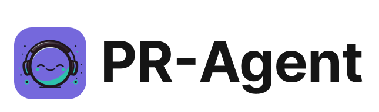
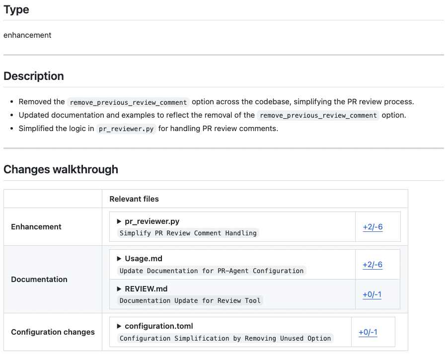
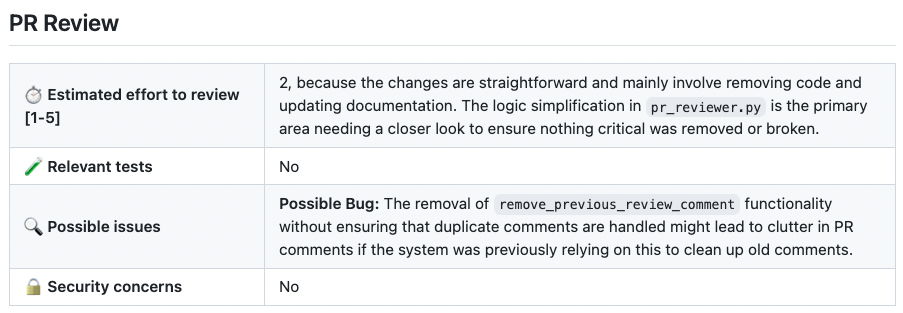
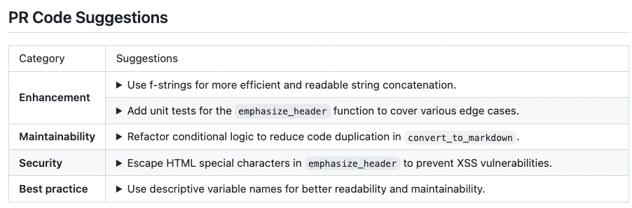
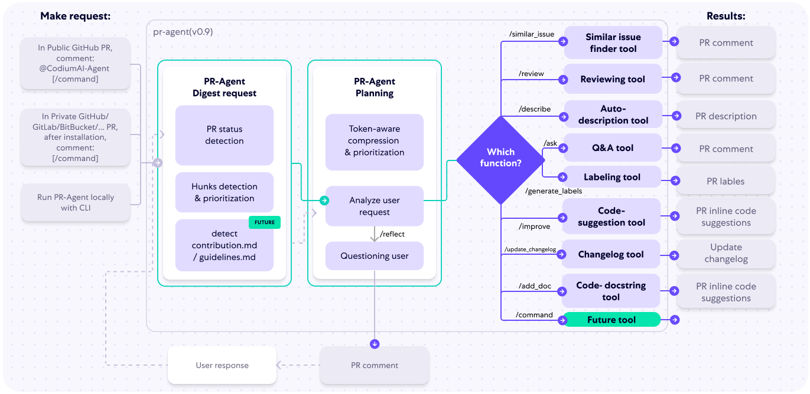

[English](README.md) | [Português (Brasil)](README.pt-BR.md) | **Español**

<br />

<div align="center">


<picture>
  <source media="(prefers-color-scheme: dark)" srcset="https://raw.githubusercontent.com/The-PR-Agent/pr-agent/main/docs/static/img/logo-dark.png" width="330">
  <source media="(prefers-color-scheme: light)" srcset="https://raw.githubusercontent.com/The-PR-Agent/pr-agent/main/docs/static/img/logo-light.png" width="330">
  

</picture>
<br>
El revisor de PR de código abierto original
<br><br>
<a href="https://github.com/The-PR-Agent/pr-agent/releases/latest">

</a>
<a href="https://pypi.org/project/pr-agent/">

</a>
<a href="https://hub.docker.com/r/pragent/pr-agent">

</a>
<a href="https://docs.pr-agent.ai/">

</a>
<a href="https://codecov.io/gh/The-PR-Agent/pr-agent">

</a>
<a href="https://github.com/The-PR-Agent/pr-agent/blob/main/LICENSE">

</a>
<a href="https://github.com/the-pr-agent/pr-agent/commits/main">

</a>
<a href="https://github.com/The-PR-Agent/pr-agent/actions/workflows/build-and-test.yaml?query=branch%3Amain">

</a>
</div>

---

 Este repositorio contiene el proyecto de código abierto PR Agent.
 No es la oferta de Qodo para proyectos de código abierto.

PR-Agent es un agente de revisión de código de código abierto impulsado por IA y un proyecto heredado mantenido por la comunidad de Qodo. Se distingue de la oferta principal de revisión de código con IA de Qodo, que ofrece una experiencia rica en funciones y sensible al contexto. Qodo ofrece una versión gratuita para proyectos de código abierto y se integra sin fricciones con GitHub, GitLab, Bitbucket y Azure DevOps para revisiones automatizadas de alta calidad.


## Patrocinadores

PR-Agent es un proyecto de código abierto mantenido por la comunidad, y su desarrollo continuo se sostiene gracias a nuestros patrocinadores. Si quieres apoyar el proyecto, considera [hacerte patrocinador](https://github.com/sponsors/naorpeled).

<p align="center">
  <h3 align="center">🥇 Patrocinador Oro</h3>
</p>

<p align="center">
  <a target="_blank" href="https://www.qodo.ai/">
    
  </a>
</p>

<p align="center">
  <a target="_blank" href="https://www.qodo.ai/solutions/open-source/">Versión gratuita de Qodo para proyectos de código abierto</a>
</p>


## Índice

- [Primeros pasos](#primeros-pasos)
- [¿Por qué usar PR-Agent?](#por-qué-usar-pr-agent)
- [Funcionalidades](#funcionalidades)
- [Míralo en acción](#míralo-en-acción)
- [Cómo funciona](#cómo-funciona)
- [Privacidad de los datos](#privacidad-de-los-datos)
- [Cómo contribuir](#cómo-contribuir)

## Primeros pasos

> [!NOTE]
> **Migración de namespace en Docker Hub.** Las versiones `0.34.2` y posteriores se publican en [`pragent/pr-agent`](https://hub.docker.com/r/pragent/pr-agent). Las versiones antiguas (hasta la `v0.31` incluida) siguen disponibles en el namespace heredado [`codiumai/pr-agent`](https://hub.docker.com/r/codiumai/pr-agent) como archivo congelado: allí no se publican imágenes nuevas. Actualiza cualquier referencia fijada de `image:` / `docker pull` / `uses: docker://` al migrar a la `0.34.2+`.

### 🚀 Inicio rápido con PR-Agent

#### 1. GitHub Action (recomendado)

Añade revisiones automáticas de PR a tu repositorio con un archivo de workflow sencillo:

```yaml
# .github/workflows/pr-agent.yml
name: PR Agent
on:
  pull_request:
    types: [opened, synchronize]
jobs:
  pr_agent_job:
    runs-on: ubuntu-latest
    steps:
    - name: PR Agent action step
      uses: the-pr-agent/pr-agent@main
      env:
        OPENAI_KEY: ${{ secrets.OPENAI_KEY }}
        GITHUB_TOKEN: ${{ secrets.GITHUB_TOKEN }}
```
[Guía completa de configuración de la GitHub Action](https://docs.pr-agent.ai/installation/github/#run-as-a-github-action)

#### 2. Uso por CLI (desarrollo local)

Ejecuta PR-Agent localmente en tu repositorio:

```bash
pip install "pr-agent[github]"
export OPENAI_KEY=your_key_here
pr-agent --pr_url https://github.com/owner/repo/pull/123 review
```
Los SDK de los proveedores Git son extras opcionales: instala el de tu proveedor ([lista](https://docs.pr-agent.ai/installation/locally/#using-pip-package)) o usa `pr-agent[all]` para todas las integraciones.
[Guía completa de configuración de la CLI](https://docs.pr-agent.ai/usage-guide/automations_and_usage/#local-repo-cli)

#### 3. Otras plataformas

- [Configuración del webhook en GitLab](https://docs.pr-agent.ai/installation/gitlab/)
- [Instalación de la app en BitBucket](https://docs.pr-agent.ai/installation/bitbucket/)
- [Configuración en Azure DevOps](https://docs.pr-agent.ai/installation/azure/)

## Noticias y novedades

Las notas completas de cada versión están en la [página de Releases](https://github.com/the-pr-agent/pr-agent/releases).


## ¿Por qué usar PR-Agent?

### 🎯 Pensado para equipos de desarrollo reales

**Rápido y asequible**: cada herramienta (`/review`, `/improve`, `/ask`) usa una sola llamada al LLM (~30 segundos, coste bajo)

**Maneja PR de cualquier tamaño**: nuestra [estrategia de compresión de PR](https://docs.pr-agent.ai/core-abilities/compression_strategy/) procesa con eficacia tanto los PR pequeños como los grandes

**Altamente personalizable**: el prompting basado en JSON permite personalizar fácilmente las categorías de revisión y el comportamiento mediante [archivos de configuración](pr_agent/settings/configuration.toml)

**Independiente de la plataforma**:
- **Proveedores Git**: GitHub, GitLab, BitBucket, Azure DevOps, Gitea
- **Despliegue**: CLI, GitHub Actions, Docker, autoalojado, webhooks
- **Modelos de IA**: OpenAI GPT, Anthropic Claude, Google Gemini, DeepSeek, Mistral y cualquier otro modelo accesible a través de LiteLLM (Azure OpenAI, AWS Bedrock, Vertex AI, Databricks, OpenRouter, Ollama y más) — consulta [Cambiar de modelo](https://docs.pr-agent.ai/usage-guide/changing_a_model/)

**Ventajas del código abierto**:
- Control total sobre tus datos y tu infraestructura
- Personaliza los prompts y el comportamiento según las necesidades de tu equipo
- Sin dependencia de un proveedor
- Desarrollo impulsado por la comunidad

## Funcionalidades

<div style="text-align:left;">

Consulta la [matriz actual de funcionalidades y soporte de proveedores Git](https://docs.pr-agent.ai/overview/supported_platforms/) en la documentación de PR-Agent.

⚠️ `/help_docs` está desactivado temporalmente desde la `v0.36.1`, a la espera de corregir un problema de exposición de credenciales ([#2445](https://github.com/the-pr-agent/pr-agent/issues/2445)).

[//]: # (- Support for additional git providers is described in [here]&#40;./docs/Full_environments.md&#41;)
___

## Míralo en acción

</div>
<h4><a href="https://github.com/the-pr-agent/pr-agent/pull/530">/describe</a></h4>
<div align="center">
<p float="center">

</p>
</div>
<hr>

<h4><a href="https://github.com/the-pr-agent/pr-agent/pull/732#issuecomment-1975099151">/review</a></h4>
<div align="center">
<p float="center">
<kbd>

</kbd>
</p>
</div>
<hr>

<h4><a href="https://github.com/the-pr-agent/pr-agent/pull/732#issuecomment-1975099159">/improve</a></h4>
<div align="center">
<p float="center">
<kbd>

</kbd>
</p>
</div>

<hr>

### Ejemplos de uso

Las herramientas de PR-Agent se ejecutan como comentario en un PR o desde la CLI. Algunas de las más habituales:

```bash
# Comentario en un PR (GitHub/GitLab/Bitbucket/…):
/describe
/review
/improve
/ask "What does this PR change?" # preguntas y respuestas en texto libre sobre el PR

# Los comandos con ámbito de issue se ejecutan sobre una issue, no sobre un PR:
/similar_issue # busca issues parecidas en el repositorio

# O localmente, mediante la CLI:
pr-agent --pr_url <PR_URL> review
pr-agent --issue_url <ISSUE_URL> similar_issue
```

Consulta la [documentación de herramientas](https://docs.pr-agent.ai/tools/#usage-examples) para ver la lista completa con comandos de ejemplo, y la página de cada herramienta para capturas y opciones.

<hr>

## Cómo funciona

El siguiente diagrama ilustra las herramientas de PR-Agent y su flujo:



## Privacidad de los datos

### PR-Agent autoalojado

- Si alojas PR-Agent con tu propia clave de API de OpenAI, el asunto queda entre tú y OpenAI. Puedes leer aquí su política de privacidad de datos de la API:
https://openai.com/enterprise-privacy

## Cómo contribuir

Para contribuir al proyecto, empieza leyendo nuestra [Guía de contribución](https://github.com/the-pr-agent/pr-agent/blob/main/CONTRIBUTING.md).

Para la verificación local, ejecuta `PYTHONPATH=. uv run pytest` desde la raíz del repositorio; por defecto descubre la suite de pruebas unitarias en `tests/unittest`. Las pruebas de extremo a extremo en `tests/e2e_tests` requieren credenciales de proveedor y deben invocarse explícitamente, por ejemplo `PYTHONPATH=. uv run pytest tests/e2e_tests/test_github_app.py`.


## Gran noticia para PR-Agent

¡PR-Agent tiene una nueva casa!

Tras años construyendo esta herramienta junto a la comunidad, Qodo ha donado PR-Agent a la comunidad de código abierto, y no podríamos estar más entusiasmados con lo que viene a continuación.

El proyecto vive ahora en la organización PR-Agent de GitHub, es enteramente de la comunidad y está abierto a contribuciones y a nuevos mantenedores.

Qué más ha cambiado:
- La documentación se trasladó a [docs.pr-agent.ai](https://docs.pr-agent.ai/)
- Qodo Merge (Qodo 1.0), la URL alojada que era la versión empresarial de PR-Agent, se ha renombrado y ha evolucionado hasta convertirse en Qodo (Qodo 2.0), una plataforma completa de revisión de código con IA.

## ❤️ Comunidad

Esta publicación de código abierto permanece aquí como contribución de Qodo a la comunidad: el origen de la colaboración moderna sobre código impulsada por IA. Estamos orgullosos de compartirla e inspirar a desarrolladores de todo el mundo.

El proyecto cuenta ya con su primer mantenedor externo, Naor ([@naorpeled](https://github.com/naorpeled)), y está en proceso de ser donado a una fundación de código abierto.
