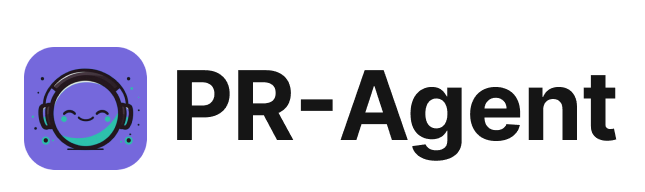
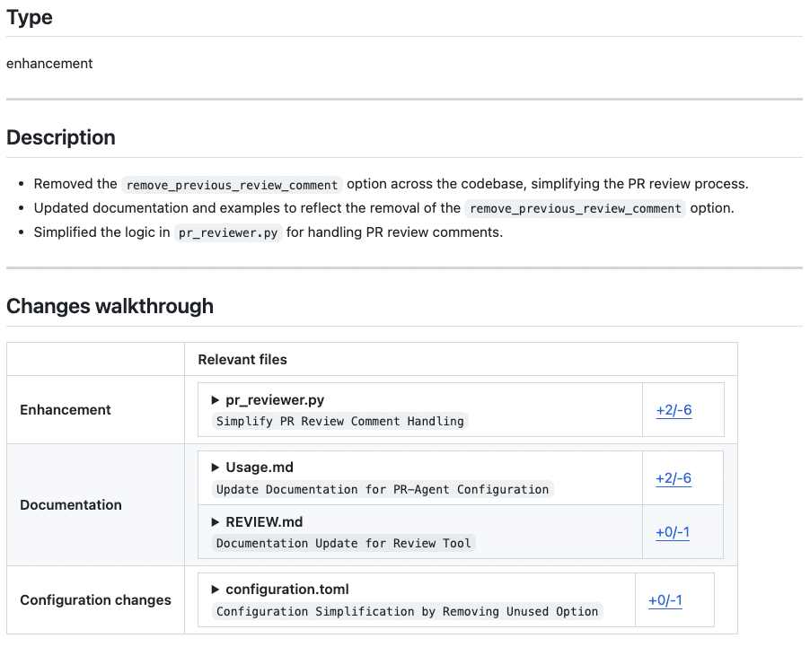
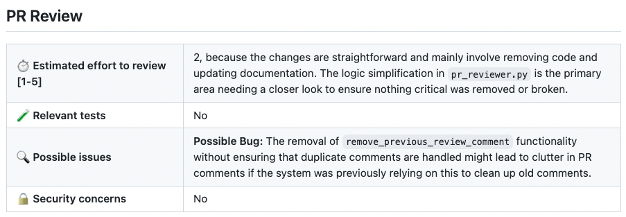
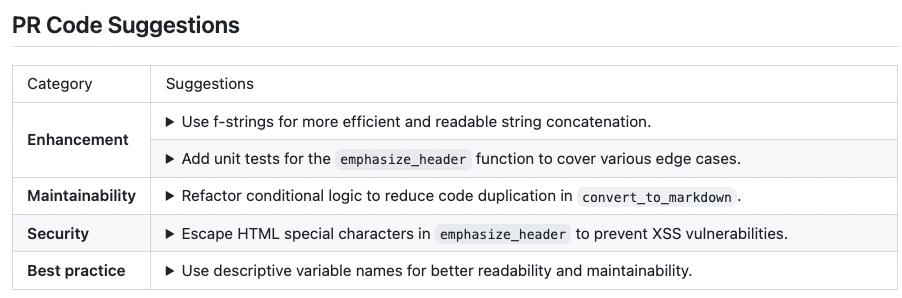
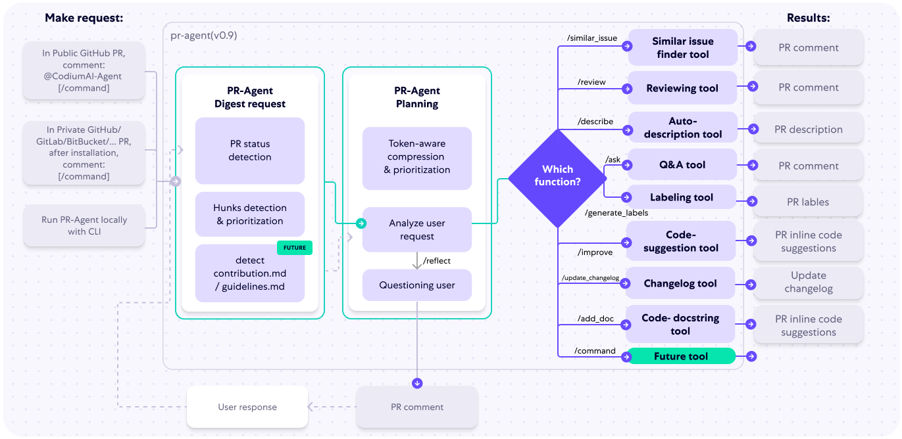

[English](README.md) | **Português (Brasil)** | [Español](README.es.md)

<br />

<div align="center">


<picture>
  <source media="(prefers-color-scheme: dark)" srcset="https://raw.githubusercontent.com/The-PR-Agent/pr-agent/main/docs/static/img/logo-dark.png" width="330">
  <source media="(prefers-color-scheme: light)" srcset="https://raw.githubusercontent.com/The-PR-Agent/pr-agent/main/docs/static/img/logo-light.png" width="330">
  

</picture>
<br>
O revisor de PR open-source original
<br><br>
<a href="https://github.com/The-PR-Agent/pr-agent/releases/latest">

</a>
<a href="https://pypi.org/project/pr-agent/">

</a>
<a href="https://hub.docker.com/r/pragent/pr-agent">

</a>
<a href="https://docs.pr-agent.ai/">

</a>
<a href="https://codecov.io/gh/The-PR-Agent/pr-agent">

</a>
<a href="https://github.com/The-PR-Agent/pr-agent/blob/main/LICENSE">

</a>
<a href="https://github.com/the-pr-agent/pr-agent/commits/main">

</a>
<a href="https://github.com/The-PR-Agent/pr-agent/actions/workflows/build-and-test.yaml?query=branch%3Amain">

</a>
</div>

---

 Este repositório contém o projeto open-source PR Agent.
 Ele não é a oferta da Qodo para projetos open-source.

O PR-Agent é um agente de revisão de código open-source movido a IA e um projeto legado mantido pela comunidade da Qodo. Ele é distinto da principal oferta de revisão de código com IA da Qodo, que entrega uma experiência rica em recursos e sensível ao contexto. A Qodo oferece uma versão gratuita para projetos open-source e se integra de forma transparente ao GitHub, GitLab, Bitbucket e Azure DevOps para revisões automatizadas de alta qualidade.


## Patrocinadores

O PR-Agent é um projeto open-source mantido pela comunidade, e seu desenvolvimento contínuo é sustentado por nossos patrocinadores. Se você quiser apoiar o projeto, considere [tornar-se um patrocinador](https://github.com/sponsors/naorpeled).

<p align="center">
  <h3 align="center">🥇 Patrocinador Ouro</h3>
</p>

<p align="center">
  <a target="_blank" href="https://www.qodo.ai/">
    
  </a>
</p>

<p align="center">
  <a target="_blank" href="https://www.qodo.ai/solutions/open-source/">Versão gratuita da Qodo para projetos open-source</a>
</p>


## Sumário

- [Primeiros passos](#primeiros-passos)
- [Por que usar o PR-Agent?](#por-que-usar-o-pr-agent)
- [Funcionalidades](#funcionalidades)
- [Veja em ação](#veja-em-ação)
- [Como funciona](#como-funciona)
- [Privacidade dos dados](#privacidade-dos-dados)
- [Como contribuir](#como-contribuir)

## Primeiros passos

> [!NOTE]
> **Migração de namespace no Docker Hub.** As versões `0.34.2` e posteriores são publicadas em [`pragent/pr-agent`](https://hub.docker.com/r/pragent/pr-agent). As versões antigas (até a `v0.31`, inclusive) continuam disponíveis no namespace legado [`codiumai/pr-agent`](https://hub.docker.com/r/codiumai/pr-agent) como um arquivo congelado — nenhuma imagem nova é publicada lá. Atualize qualquer referência fixada de `image:` / `docker pull` / `uses: docker://` ao migrar para a `0.34.2+`.

### 🚀 Início rápido com o PR-Agent

#### 1. GitHub Action (recomendado)

Adicione revisões automáticas de PR ao seu repositório com um arquivo de workflow simples:

```yaml
# .github/workflows/pr-agent.yml
name: PR Agent
on:
  pull_request:
    types: [opened, synchronize]
jobs:
  pr_agent_job:
    runs-on: ubuntu-latest
    steps:
    - name: PR Agent action step
      uses: the-pr-agent/pr-agent@main
      env:
        OPENAI_KEY: ${{ secrets.OPENAI_KEY }}
        GITHUB_TOKEN: ${{ secrets.GITHUB_TOKEN }}
```
[Guia completo de configuração da GitHub Action](https://docs.pr-agent.ai/installation/github/#run-as-a-github-action)

#### 2. Uso pela CLI (desenvolvimento local)

Rode o PR-Agent localmente no seu repositório:

```bash
pip install "pr-agent[github]"
export OPENAI_KEY=your_key_here
pr-agent --pr_url https://github.com/owner/repo/pull/123 review
```
Os SDKs dos provedores Git são extras opcionais: instale o do seu provedor ([lista](https://docs.pr-agent.ai/installation/locally/#using-pip-package)) ou use `pr-agent[all]` para todas as integrações.
[Guia completo de configuração da CLI](https://docs.pr-agent.ai/usage-guide/automations_and_usage/#local-repo-cli)

#### 3. Outras plataformas

- [Configuração de webhook no GitLab](https://docs.pr-agent.ai/installation/gitlab/)
- [Instalação do app no BitBucket](https://docs.pr-agent.ai/installation/bitbucket/)
- [Configuração no Azure DevOps](https://docs.pr-agent.ai/installation/azure/)

## Notícias e novidades

As notas completas de cada versão estão na [página de Releases](https://github.com/the-pr-agent/pr-agent/releases).


## Por que usar o PR-Agent?

### 🎯 Feito para times de desenvolvimento de verdade

**Rápido e acessível**: cada ferramenta (`/review`, `/improve`, `/ask`) usa uma única chamada ao LLM (~30 segundos, custo baixo)

**Lida com PRs de qualquer tamanho**: nossa [estratégia de compressão de PR](https://docs.pr-agent.ai/core-abilities/compression_strategy/) processa com eficácia tanto PRs pequenos quanto grandes

**Altamente personalizável**: o prompting baseado em JSON permite personalizar facilmente as categorias de revisão e o comportamento por meio de [arquivos de configuração](pr_agent/settings/configuration.toml)

**Independente de plataforma**:
- **Provedores Git**: GitHub, GitLab, BitBucket, Azure DevOps, Gitea
- **Implantação**: CLI, GitHub Actions, Docker, auto-hospedado, webhooks
- **Modelos de IA**: OpenAI GPT, Anthropic Claude, Google Gemini, DeepSeek, Mistral e qualquer outro modelo acessível pelo LiteLLM (Azure OpenAI, AWS Bedrock, Vertex AI, Databricks, OpenRouter, Ollama e outros) — veja [Trocando de modelo](https://docs.pr-agent.ai/usage-guide/changing_a_model/)

**Vantagens do open source**:
- Controle total sobre seus dados e sua infraestrutura
- Personalize prompts e comportamento para as necessidades do seu time
- Sem aprisionamento a fornecedor
- Desenvolvimento conduzido pela comunidade

## Funcionalidades

<div style="text-align:left;">

Veja a [matriz atual de funcionalidades e suporte a provedores Git](https://docs.pr-agent.ai/overview/supported_platforms/) na documentação do PR-Agent.

⚠️ O `/help_docs` está temporariamente desativado desde a `v0.36.1`, aguardando a correção de um problema de exposição de credenciais ([#2445](https://github.com/the-pr-agent/pr-agent/issues/2445)).

[//]: # (- Support for additional git providers is described in [here]&#40;./docs/Full_environments.md&#41;)
___

## Veja em ação

</div>
<h4><a href="https://github.com/the-pr-agent/pr-agent/pull/530">/describe</a></h4>
<div align="center">
<p float="center">

</p>
</div>
<hr>

<h4><a href="https://github.com/the-pr-agent/pr-agent/pull/732#issuecomment-1975099151">/review</a></h4>
<div align="center">
<p float="center">
<kbd>

</kbd>
</p>
</div>
<hr>

<h4><a href="https://github.com/the-pr-agent/pr-agent/pull/732#issuecomment-1975099159">/improve</a></h4>
<div align="center">
<p float="center">
<kbd>

</kbd>
</p>
</div>

<hr>

### Exemplos de uso

As ferramentas do PR-Agent rodam como comentário em um PR ou pela CLI. Algumas das mais comuns:

```bash
# Comentário em um PR (GitHub/GitLab/Bitbucket/…):
/describe
/review
/improve
/ask "What does this PR change?" # perguntas e respostas em texto livre sobre o PR

# Comandos com escopo de issue rodam em uma issue, não em um PR:
/similar_issue # encontra issues parecidas no repositório

# Ou localmente, pela CLI:
pr-agent --pr_url <PR_URL> review
pr-agent --issue_url <ISSUE_URL> similar_issue
```

Veja a [documentação das ferramentas](https://docs.pr-agent.ai/tools/#usage-examples) para a lista completa com exemplos de comandos, e a página de cada ferramenta para capturas de tela e opções.

<hr>

## Como funciona

O diagrama a seguir ilustra as ferramentas do PR-Agent e seu fluxo:



## Privacidade dos dados

### PR-Agent auto-hospedado

- Se você hospeda o PR-Agent com a sua chave de API da OpenAI, isso é entre você e a OpenAI. A política de privacidade de dados da API deles pode ser lida aqui:
https://openai.com/enterprise-privacy

## Como contribuir

Para contribuir com o projeto, comece lendo nosso [Guia de Contribuição](https://github.com/the-pr-agent/pr-agent/blob/main/CONTRIBUTING.md).

Para verificação local, rode `PYTHONPATH=. uv run pytest` a partir da raiz do repositório; por padrão ele descobre a suíte de testes unitários em `tests/unittest`. Os testes de ponta a ponta em `tests/e2e_tests` exigem credenciais de provedor e devem ser invocados explicitamente, por exemplo `PYTHONPATH=. uv run pytest tests/e2e_tests/test_github_app.py`.


## Grande novidade para o PR-Agent

O PR-Agent tem uma nova casa!

Depois de anos construindo esta ferramenta junto com a comunidade, a Qodo doou o PR-Agent para a comunidade open-source — e não poderíamos estar mais animados com o que vem a seguir.

O projeto agora vive na organização PR-Agent no GitHub, é totalmente da comunidade e está aberto a contribuições e a novos mantenedores.

O que mais mudou:
- A documentação foi para [docs.pr-agent.ai](https://docs.pr-agent.ai/)
- O Qodo Merge (Qodo 1.0), a URL hospedada que era a versão corporativa do PR-Agent, foi renomeado e evoluiu para o Qodo (Qodo 2.0), uma plataforma completa de revisão de código com IA.

## ❤️ Comunidade

Este lançamento open-source permanece aqui como uma contribuição da Qodo à comunidade — a origem da colaboração moderna em código movida a IA. Temos orgulho de compartilhá-lo e de inspirar pessoas desenvolvedoras no mundo todo.

O projeto agora tem seu primeiro mantenedor externo, Naor ([@naorpeled](https://github.com/naorpeled)), e está em processo de doação para uma fundação open-source.
